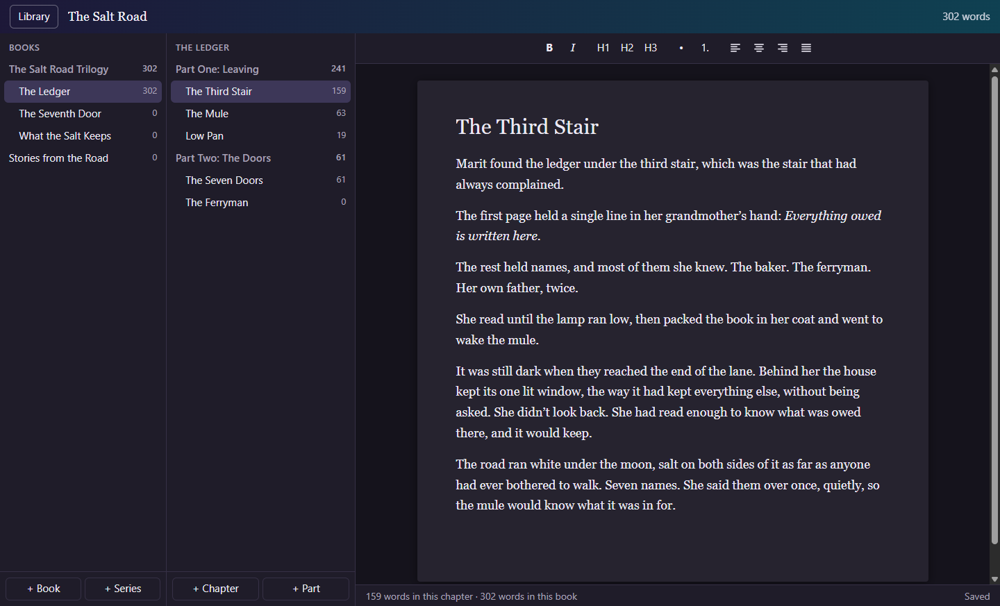

<div align="center">

<a href="https://recontowers.com/projects/storytracker/"></a>

<br>

[](https://github.com/neogentrics/StoryTracker/releases/latest)
[](https://github.com/neogentrics/StoryTracker/actions/workflows/ci.yml)
[](#download)
[](#how-your-writing-is-kept)

**[Download](#download)** &nbsp;·&nbsp; **[What it does](#what-it-does)** &nbsp;·&nbsp; **[Roadmap](ROADMAP.md)** &nbsp;·&nbsp; **[What's new](CHANGELOG.md)** &nbsp;·&nbsp; **[Project page](https://recontowers.com/projects/storytracker/)**

</div>

<br>

A place to write a book and keep everything around it: chapters today, then characters, timelines, lore, ideas, research
and where every book stands. For any author, on Windows, Mac and Linux, with nothing to set up and no account.

RT Story Tracker is part of the **Recon Towers** suite, built by its Dev Department. Version 3.0 is a new app, rebuilt from
scratch. Versions 1.0 to 2.3 were a Windows-only app called StoryTracker that needed a PostgreSQL server.

<table>
<tr>
<td width="50%"><br><b>Write.</b> A clean page, with your books and chapters beside it.</td>
<td width="50%"><br><b>Format.</b> Headings, lists and alignment, with Markdown shortcuts if you like them.</td>
</tr>
<tr>
<td><br><b>Day or night.</b> It follows your system's light or dark setting.</td>
<td><br><b>Your library.</b> Every project in one place, with nothing to set up.</td>
</tr>
</table>

## Download

> [!NOTE]
> Version 3.0 hasn't had its first release yet. The newest download on the releases page is still the old Windows app,
> 2.3.0, which needs a PostgreSQL server. You can run the new app from the source below.

| Windows | macOS | Linux |
|---|---|---|
| `.exe` installer | `.dmg` for Apple silicon or Intel | `AppImage` or `.deb` |

The builds aren't code-signed yet, so Windows may show a SmartScreen warning the first time, and macOS will ask you to
open the app from *System Settings → Privacy & Security*.

## What it does

| | |
|---|---|
| **A page to write on** | Bold, italic, three heading sizes, lists and alignment |
| **Markdown shortcuts** | Type `#` and a space for a heading, `-` and a space for a list, or `**bold**` |
| **Series, books, parts, chapters** | Three columns, as in the old app. A project holds series and books, and a book holds parts and chapters |
| **Move things around** | Drag a chapter to reorder it, into a part, or to another book. Alt and the arrow keys work too |
| **Live word counts** | For the chapter, the book and the whole project, as you type |
| **Saves itself** | A couple of seconds after you pause, and every five seconds while you type. There's no Save button to forget |
| **Picks up where you left off** | Reopens the project and chapter you were in |
| **Private by default** | Every project is encrypted on your own computer |
| **Works offline** | No account, no server, and nothing leaves your computer |
| **Updates itself** | On Windows and the Linux AppImage. Mac and the `.deb` tell you when a new version is out |

Coming next: spell check and themes (3.1), version history and backups (3.2), export (3.3), import (3.4) and the password
lock (3.6), then characters, timelines and lore. See the [roadmap](ROADMAP.md).

## How your writing is kept

Every project is an encrypted database in the app's own folder, with its own random key. A project with no password can be
opened by any copy of this app, so that's privacy from a casual look, not secrecy. The password lock in 3.6 is what makes it
real. Only things with no writing in them can be removed for now, so no click can lose a chapter.

Tests kill the app outright while it's saving, on all three systems, and every reported save survives. The numbers are in
the [database design](docs/design/database.md#the-test-with-encryption-on).

## Running it from the source

You need Node.js 22 or newer.

```bash
npm install
```

```bash
npm start
```

```bash
npm test
```

```bash
npm run test:e2e
```

## How the code is laid out

- `src/main`: everything that runs outside the window. `workspace.js` checks every request from the window.
- `src/main/storage`: the only code that touches a project.
- `src/renderer`: the screens and the editor, bundled into `dist/renderer` by `npm run build:renderer`.
- `src/shared`: what both sides need, so the word count on screen and the saved one can't disagree.
- `legacy-wpf`: the old C# app, kept for reference. It isn't built or shipped.

The plan behind it all is in the [product plan](docs/product-plan.md), the [decisions](docs/decisions.md) and the designs for
the [database](docs/design/database.md), [file types](docs/design/file-types.md),
[passwords and recovery](docs/design/passwords-and-recovery.md) and
[working with RT Markdown Reader](docs/design/working-with-rt-markdown-reader.md).

## Licence

Proprietary, with the source public for reference. See [LICENSE](LICENSE) and
[THIRD_PARTY_NOTICES.md](THIRD_PARTY_NOTICES.md).
